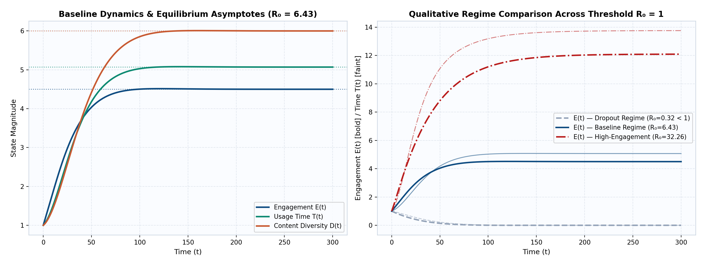
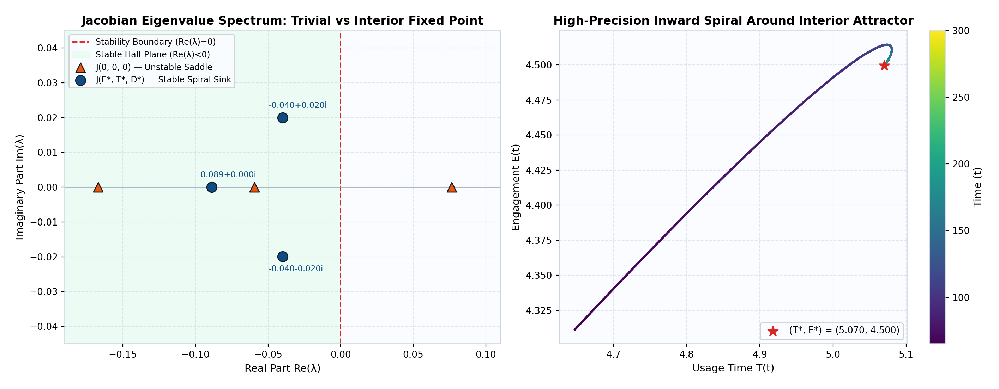
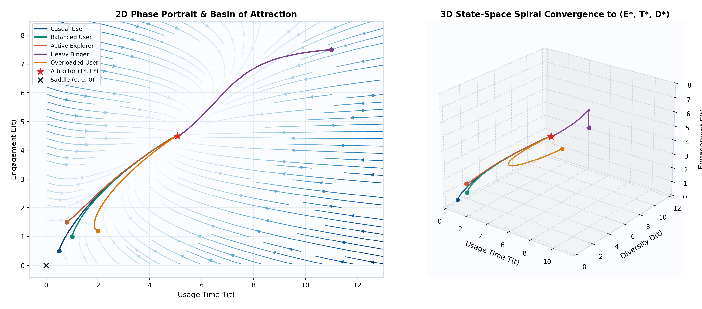
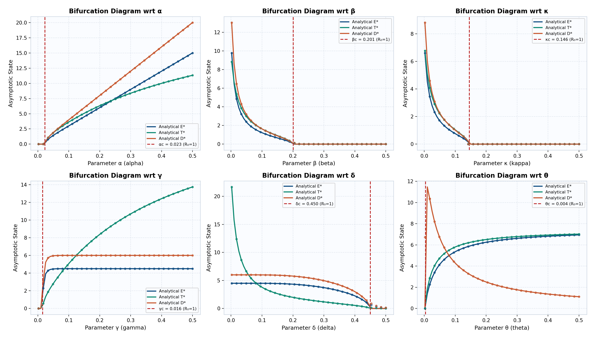
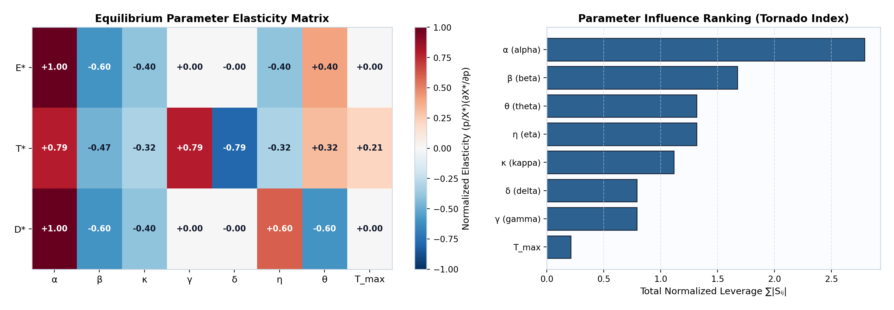
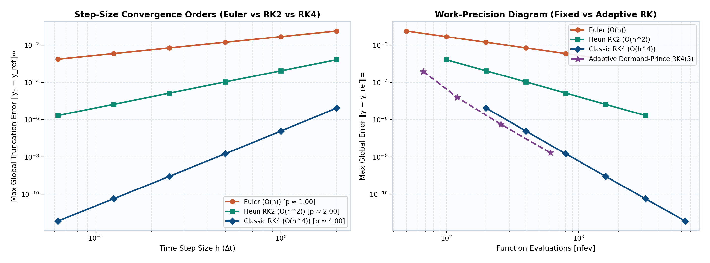
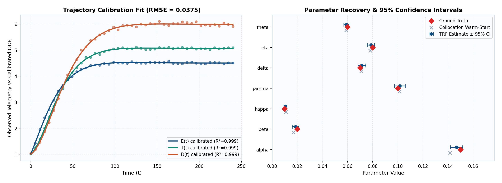
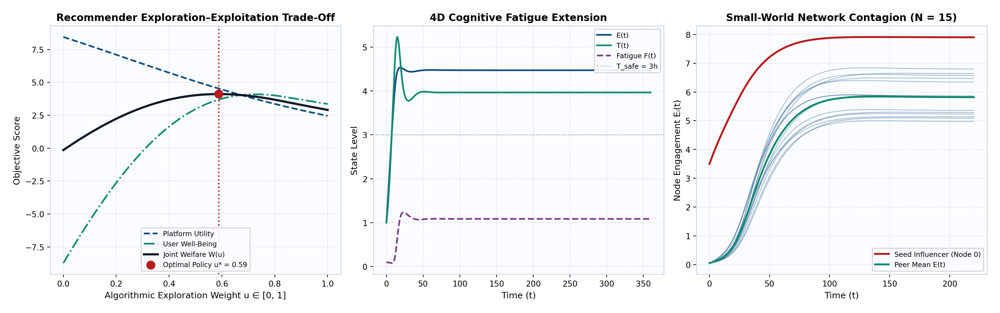

# Social Network Dynamics via Ordinary Differential Equations

[](https://github.com/Arturvpf/social-network-dynamics-ode/actions/workflows/ci.yml)
[](https://www.python.org/)
[](LICENSE)

> **Leia em Português:** [README.pt-BR.md](README.pt-BR.md) | **Mathematical Proofs:** [docs/MATHEMATICAL_ANALYSIS.md](docs/MATHEMATICAL_ANALYSIS.md) | **Academic Notebook (PT-BR):** [notebooks/social_network_ode_model.ipynb](notebooks/social_network_ode_model.ipynb)

A complete mathematical, numerical, and algorithmic toolkit modeling **user behavior in social networks** as a coupled system of **nonlinear ordinary differential equations (ODEs)**. Originally developed for the *Computational Numerical Methods* course at **CIn/UFPE**, this repository combines closed-form dynamical systems theory, custom Runge–Kutta solvers with empirical convergence proofs, two-stage nonlinear parameter calibration, recommendation policy optimization, and a zero-dependency interactive browser laboratory.



---

## Mathematical Formulation

The model tracks three coupled continuous-time behavioral variables $\mathbf{y}(t) = [E(t),\; T(t),\; D(t)]^\top \in \mathbb{R}_{\ge 0}^3$:

- **$E(t)$ — User Engagement:** Active interaction intensity on the platform.
- **$T(t)$ — Platform Usage Time:** Daily hours spent on the platform, physically bounded by $T_{\max} > 0$.
- **$D(t)$ — Content Diversity:** Variety of topics/creators consumed over time.

$$
\begin{cases}
\dfrac{dE}{dt} = \alpha \tanh(T) - \beta E - \kappa D \\[8pt]
\dfrac{dT}{dt} = \gamma E \left(1 - \dfrac{T}{T_{\max}}\right) - \delta T \\[8pt]
\dfrac{dD}{dt} = \eta E - \theta D
\end{cases}
$$

with Filippov tangent-cone non-negativity projection on $\partial \mathbb{R}_{\ge 0}^3$. Every trajectory is absorbed into the compact positively invariant box $\Omega = [0, \alpha/\beta] \times [0, T_{\sup}] \times [0, \alpha\eta/(\beta\theta)]$ with $T_{\sup} < T_{\max}$.

### Exact Activation Threshold $\mathcal{R}_0$ & Stability Theorem

Eliminating $D^* = (\eta/\theta)E^*$ and $E^*(T^*)$ reduces equilibrium existence to a strictly monotonic scalar equation governed by the dimensionless **Platform Activation Number**:

$$
\mathcal{R}_0 = \frac{\alpha \gamma \theta}{\delta (\beta \theta + \kappa \eta)}
$$

| Regime | Condition | Trivial Point $(0,0,0)$ | Interior Equilibrium $(E^*, T^*, D^*)$ | Behavioral Interpretation |
| :--- | :---: | :---: | :---: | :--- |
| **Subcritical** | $\mathcal{R}_0 \le 1$ | **Globally Stable** | Does not exist in $\mathbb{R}_{>0}^3$ | Platform abandonment / churn |
| **Bifurcation** | $\mathcal{R}_0 = 1$ | Non-hyperbolic ($\det J_0 = 0$) | Coalesces with $(0,0,0)$ | Exact **Transcritical Bifurcation** |
| **Supercritical (Baseline)** | $\mathcal{R}_0 = 6.43 > 1$ | Unstable Saddle ($\lambda_1 = +0.0765$) | **Stable Spiral Sink** $(4.500, 5.070, 6.000)$ | Sustained engagement equilibrium |



At the baseline parameters ($\alpha=0.15, \beta=0.02, \kappa=0.01, \gamma=0.10, \delta=0.07, \eta=0.08, \theta=0.06, T_{\max}=24$), the analytical Jacobian $J(E^*, T^*, D^*)$ satisfies all Routh–Hurwitz criteria ($c_1 > 0, c_3 > 0, \Delta_2 = c_1 c_2 - c_3 > 0$) with eigenvalues $\lambda_{1,2} = -0.03999 \pm 0.01998i$ and $\lambda_3 = -0.08877$.

---

## Key Capabilities & Visual Highlights

### 1. Phase-Space Geometry & Global Basin of Attraction
2D quasi-steady manifold streamplots and 3D trajectories across diverse user archetypes (*Casual*, *Balanced*, *Active Explorer*, *Heavy Binger*, *Information-Overloaded*) demonstrating global convergence to $(E^*, T^*, D^*)$:



### 2. Analytical Bifurcations & Parameter Elasticity Matrix
Exact closed-form critical thresholds ($\alpha_c = 0.0233, \beta_c = 0.2010, \kappa_c = 0.1457, \gamma_c = 0.0156, \delta_c = 0.4500, \theta_c = 0.0042$) overlaid on steady-state numerical sweeps, paired with normalized local elasticities $S_{ij} = \frac{p_j}{X_i^*}\frac{\partial X_i^*}{\partial p_j}$:




### 3. Numerical Methods Convergence Benchmark (From Scratch)
Custom implementations of **Forward Euler** $O(h)$, **Heun's RK2** $O(h^2)$, **Classical RK4** $O(h^4)$, and **Adaptive Dormand–Prince RK4(5)** benchmarked against an 8th-order `DOP853` (`rtol=1e-13`) reference trajectory:



### 4. Two-Stage Nonlinear Parameter Calibration
Derivative-matching collocation warm-start (`lsq_linear`) followed by full-trajectory Trust-Region Reflective nonlinear least squares (`least_squares`), recovering all 7 kinetic parameters with 95% Gauss–Newton confidence intervals and $R^2 = 0.999$:



### 5. Recommender Policy Optimization, 4D Fatigue & Networked ODEs
Optimizes an algorithmic exploration–exploitation dial $u \in [0, 1]$ to balance platform retention and digital well-being ($u^* \approx 0.59$), extends the state space to a **4D Cognitive Fatigue system** $(E, T, D, F)$, and generalizes dynamics to **Watts–Strogatz Small-World social graphs** ($N = 15$):



---

## Interactive Web Simulator

Open [`simulator/index.html`](simulator/index.html) directly in any browser—or launch it via CLI—to explore:
- **Live Sliders & Presets:** Real-time updates of $\mathcal{R}_0$, $(E^*, T^*, D^*)$, Cardano Jacobian eigenvalues $\lambda_{1,2,3}$, and Routh–Hurwitz margin $\Delta_2$.
- **Interactive Phase Plane:** Click anywhere in $(T, E)$ space to spawn additional trajectories and test the basin of attraction.
- **Draggable 3D Orbit Viewer:** Rotate azimuth and elevation interactively.
- **4 Modes:** `3D Model`, `4D Fatigue`, `Euler vs RK4` step-error lab, and `Policy Optimization` ($u \in [0, 1]$) with instant `EN` / `PT-BR` language switching.

```bash
social-ode serve-simulator --port 8080
```

---

## Installation & Quickstart

```bash
git clone https://github.com/Arturvpf/social-network-dynamics-ode.git
cd social-network-dynamics-ode
pip install -e ".[dev]"
```

### Command-Line Interface (`social-ode`)

```bash
# 1. Analytical equilibria, R0, critical thresholds, and Routh-Hurwitz report (or --json)
social-ode equilibrium

# 2. Simulate trajectory with custom Classic RK4 or Adaptive Dormand-Prince and export CSV
social-ode simulate --method rk4 --dt 0.1 --t-end 300 --csv output/trajectory.csv

# 3. Verify empirical convergence orders (p = 1.00, 2.00, 4.00)
social-ode convergence

# 4. Calibrate parameters from noisy synthetic telemetry with 95% confidence intervals
social-ode calibrate --n-obs 45 --noise 0.04

# 5. Optimize recommender exploration-exploitation weight u*
social-ode policies

# 6. Regenerate all publication figures (supports --lang en or --lang pt)
social-ode generate-figures --output-dir figures --lang en
```

### Python API Example

```python
from social_network_ode import DEFAULT_PARAMS, analyze_equilibria, simulate

report = analyze_equilibria(DEFAULT_PARAMS)
print(f"R0 = {report.r0:.4f}, Equilibrium = {report.nontrivial.state}")
print(f"Classification: {report.nontrivial.classification}, Eigenvalues = {report.nontrivial.eigenvalues}")

result = simulate(DEFAULT_PARAMS, y0=(1.0, 1.0, 1.0), t_span=(0, 300), method="dopri45")
```

### Running Tests & Academic Notebook

```bash
pytest -v
jupyter notebook notebooks/social_network_ode_model.ipynb
```

---

## Repository Structure

```text
.
├── .github/workflows/ci.yml               # Automated test, CLI & notebook validation pipeline
├── docs/MATHEMATICAL_ANALYSIS.md          # Formal proofs (positivity, bounds, R0, Routh-Hurwitz)
├── figures/                               # Deterministic 200-DPI visual gallery
├── notebooks/
│   └── social_network_ode_model.ipynb     # Full academic study in Portuguese (CIn/UFPE)
├── simulator/
│   └── index.html                         # Standalone HTML5/Canvas interactive ODE laboratory
├── src/social_network_ode/
│   ├── model.py                           # ODE system, Filippov guard, Jacobian & invariant box
│   ├── stability.py                       # R0, critical parameters, equilibria & Routh-Hurwitz
│   ├── solvers.py                         # Custom Euler, RK2, RK4, Dormand-Prince & benchmarks
│   ├── sensitivity.py                     # Bifurcation sweeps, elasticities & IC ensembles
│   ├── calibration.py                     # Two-stage nonlinear least-squares calibration + CIs
│   ├── extensions.py                      # Saturation kernels, 4D fatigue, policy u* & graph ODEs
│   ├── plotting.py                        # Bilingual (EN / PT-BR) Matplotlib figure builders
│   └── cli.py                             # `social-ode` command-line interface
├── tests/                                 # 33 unit & integration tests (pytest)
├── pyproject.toml
├── requirements.txt
├── README.md
└── README.pt-BR.md
```

---

## Authors

- **Andreywid Yago Lima de Souza** (`ayls@cin.ufpe.br`)
- **Artur Vinicius Pereira Fernandes** (`arturvpf3@gmail.com`)
- **Breno Ramos de Souza Gomes** (`brsg@cin.ufpe.br`)
- **Valter Sanches Martins Neto** (`vsmn@cin.ufpe.br`)
- **Manoel Lira de Carvalho** (`mlc6@cin.ufpe.br`)

*Centro de Informática (CIn) — Universidade Federal de Pernambuco (UFPE).*

## References

- Tu, H. T., Phan, T. T., & Nguyen, K. P. (2022). *Modeling information diffusion in social networks with ordinary linear differential equations.* Information Sciences, 593, 614–636.
- Strogatz, S. H. (2018). *Nonlinear Dynamics and Chaos* (2nd ed.). CRC Press.
- Dormand, J. R., & Prince, P. J. (1980). *A family of embedded Runge-Kutta formulae.* Journal of Computational and Applied Mathematics, 6(1), 19–26.
- Virtanen, P. et al. (2020). *SciPy 1.0: Fundamental Algorithms for Scientific Computing in Python.* Nature Methods, 17, 261–272.
- Zhang, Y., & Chen, X. (2020). *Explainable Recommendation: A Survey and New Perspectives.* Foundations and Trends in Information Retrieval, 14(1), 1–101.
